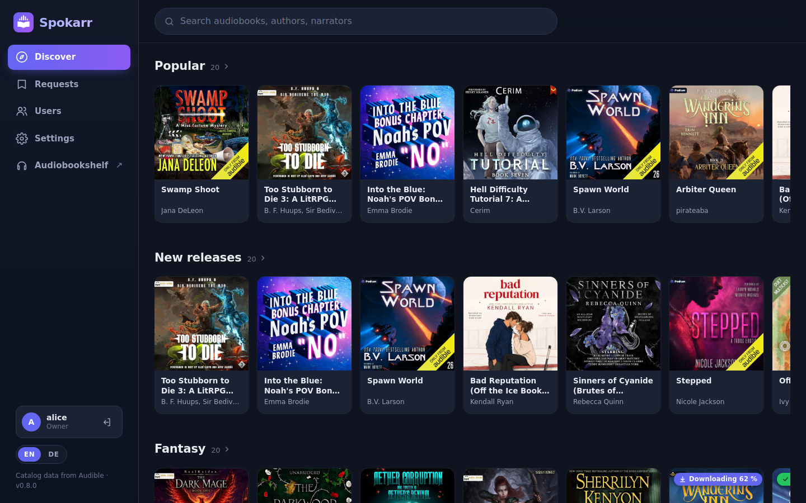
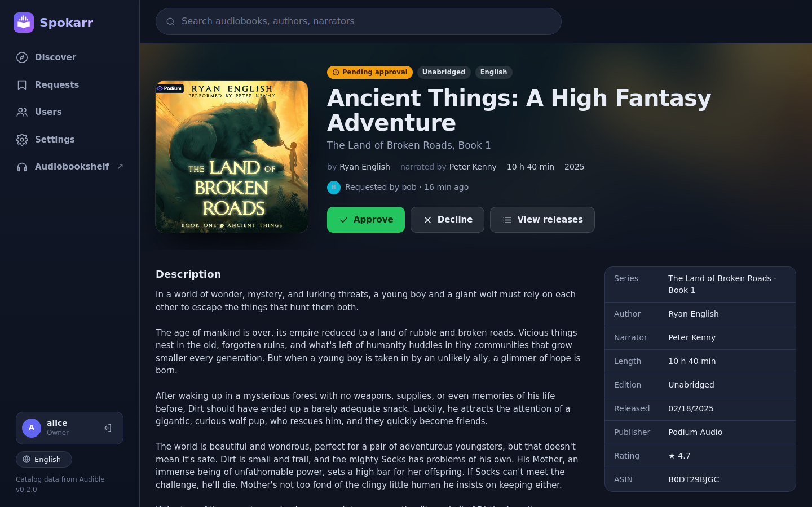
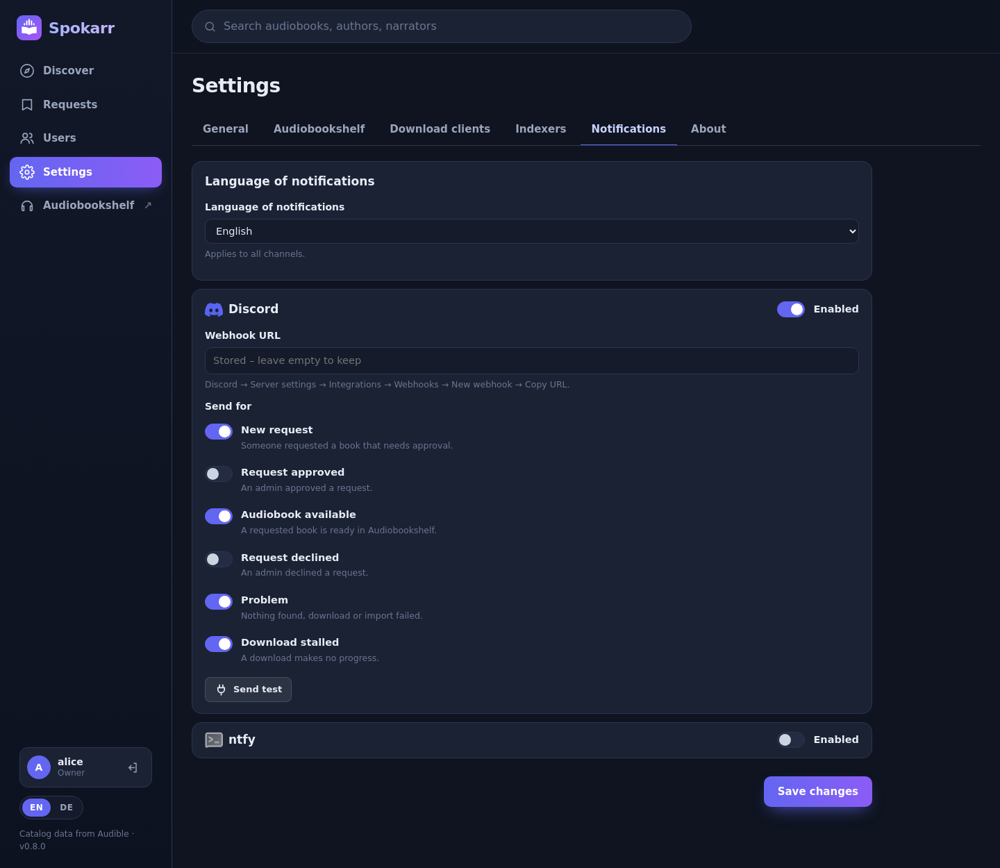
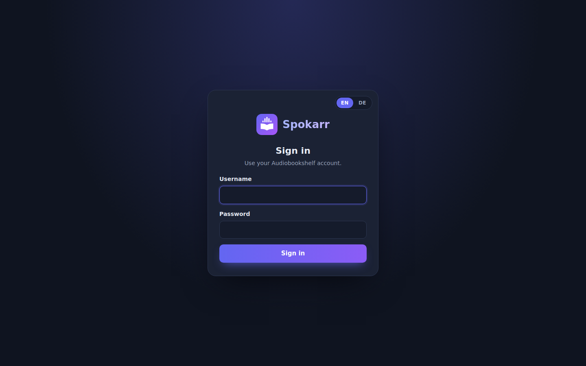
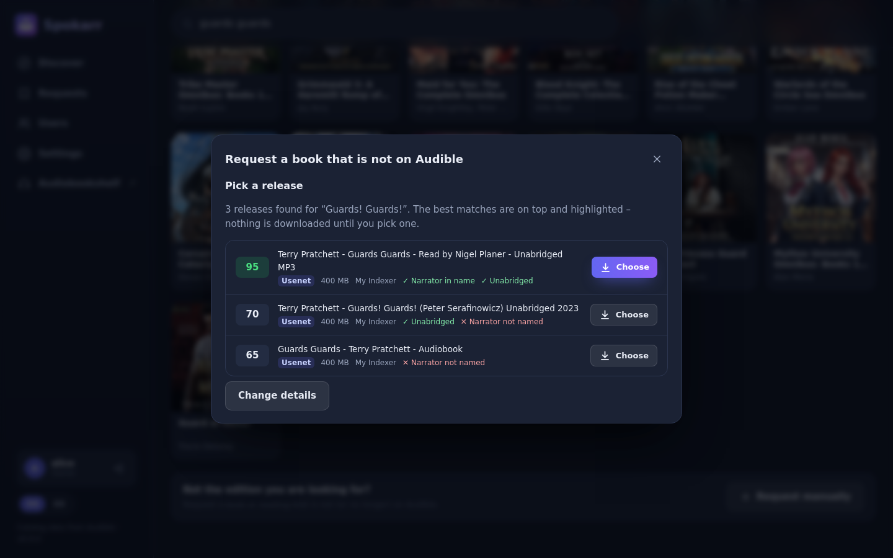
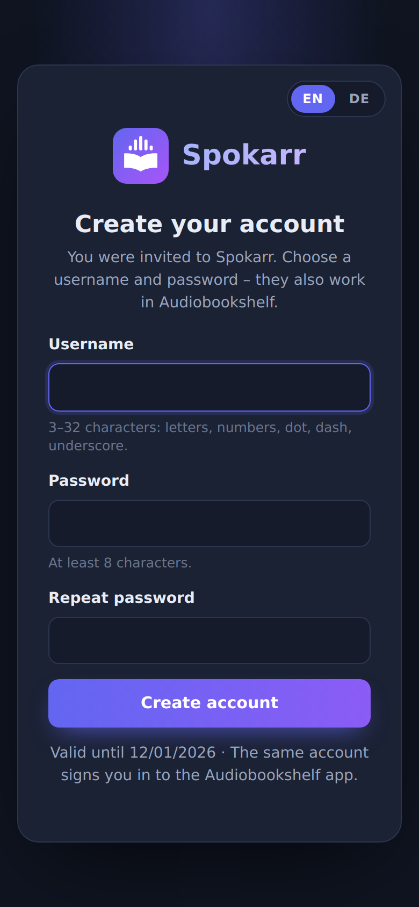

<p align="center"></p>

<h1 align="center">Spokarr</h1>

<p align="center">
  <b>Request audiobooks like you request movies in Seerr.</b><br>
  Spokarr finds the exact edition you want, downloads it and files it into your Audiobookshelf library.
</p>

<p align="center">
  <a href="https://github.com/BlugDeg/Spokarr/actions/workflows/docker.yml"></a>
  <a href="https://github.com/BlugDeg/Spokarr/releases"></a>
  
  
  
  
  
</p>

<p align="center"></p>

---

## What makes Spokarr different

- **The exact recording, not just the book.** You pick an edition from the Audible catalog – narrator,
  unabridged or abridged, language – and Spokarr scores every release against it. A full-cast
  dramatization or an English release won't sneak in when you asked for a German reading.
- **Built for audiobooks in any language.** Every Audible store works (US, UK, DE, FR, IT, ES, JP, …),
  release names in other languages are matched properly, umlauts included.
- **No new accounts.** Everyone signs in with their Audiobookshelf account; requests show up in
  Audiobookshelf tagged with who asked for them.
- **Light enough for a Raspberry Pi.** One small Node.js process without dependencies and JSON files
  instead of a database.

### Why not Readarr?

Readarr is built around *books*. Its metadata rarely knows narrators, editions or non-English titles,
so getting the recording you want is guesswork. Spokarr starts from the Audible catalog instead, finds a
matching release on your indexers (directly or through Prowlarr), sends it to SABnzbd, NZBGet, qBittorrent, Transmission or Deluge
and hands the finished book to Audiobookshelf – already matched, with cover, chapters and narrator.

## Features

**For listeners**
- 🔎 **Discover and search** the Audible catalog of any store (US, UK, DE, FR, …) – covers, narrators,
  length, series, abridged or unabridged.
- 🏷️ **Genres**: browse any Audible category, add genre rows to Discover and sort by popularity,
  rating, release date or length. Every row opens as a page of its own. The book page shows the
  genre, and genres you never want to see (say, Romance) can be hidden from Discover.
- ➕ **One-tap requests** and a clear status for every book: pending, downloading with progress,
  available.
- ✍️ **Manual requests** for books Audible no longer sells or never had – older readings, other narrators,
  radio plays, CD editions: enter title, author and narrator, Spokarr searches your indexers and you pick
  the release from the list.
- 🎧 **Straight to listening**: “Listen in Audiobookshelf” opens the book in your library.
- 🔐 **Sign in with Audiobookshelf** – same username and password, no extra accounts. Spokarr never
  stores passwords.
- 📱 **Mobile first**, installable as a home-screen app. English and German interface.

**For admins**
- ✅ **Approval workflow** like Seerr: per-user permissions to request, auto-approve and manage requests.
- 👥 **User management** with roles, request counts and last sign-in – plus a one-click import of all
  Audiobookshelf users.
- ✉️ **Invite links**: send a link, the person picks a username and password, and Spokarr creates the
  account in Audiobookshelf and in Spokarr. Valid for 1, 7 or 30 days, once or several times.
- 🔐 **Single sign-on (OIDC)**: sign in through Authentik, Authelia, Keycloak, Pocket ID & co. – matched
  to the Audiobookshelf account by username or email. Password sign-in stays available.
- 🔄 **Update notice**: admins see at the bottom left when a new release is out (can be switched off).
- 🧠 **Smart release matching**: every result is scored on title, author, narrator, language, abridged vs.
  unabridged, dramatizations and size per minute. Short titles (“The Knot”) are only picked when the
  release also names the author – optionally for every title. “View releases” shows the score and the
  reasons, and lets you pick a release by hand.
- 🗂️ **Clean import**: downloads are moved to `Author/Title`, get a `metadata.json` and a cover,
  Audiobookshelf scans and matches the book, and it is tagged “Requested by &lt;name&gt;”.
- 📑 **Real chapters**: releases with one file per CD track get proper chapters from the files' title
  tags – or from Audible, when the runtime matches.
- 🔌 **Prowlarr, SABnzbd, NZBGet, qBittorrent, Transmission and Deluge**: search all your Prowlarr indexers at once or add Newznab
  indexers directly; usenet releases go to SABnzbd or NZBGet, torrents to qBittorrent, Transmission or Deluge. Torrents keep seeding –
  Spokarr hardlinks (or copies) the files into the library.
- 🔔 **Notifications** via Discord and ntfy: new requests waiting for approval, approvals, books ready to
  listen to, declined requests and problems – in English or German, with cover and a link to the book.
- 🐌 **Stalled downloads** are detected (no progress for a configurable time) and reported. “Search again”
  picks another release and removes the stalled one from the download client – only if a better release
  was found.
- ⚙️ **Settings in the browser**: Audible store, discover rows, Audiobookshelf, download clients, Prowlarr
  and indexers – each with a connection test, plus path mapping when a client sees the disk differently.
- 🪶 **Lightweight**: plain Node.js without dependencies and JSON files instead of a database – runs fine
  on a Raspberry Pi.

## Screenshots

| Discover | Book details |
|---|---|
|  |  |
| **Requests** | **Users and invite links** |
|  |  |
| **Prowlarr and indexers** | **Download clients** |
|  |  |
| **Notifications** | **Sign in with Audiobookshelf** |
|  |  |
| **Manual request: pick the release** | |
|  | |

<p align="center">
  
  &nbsp;
  
  &nbsp;
  
  &nbsp;
  
</p>

## How it works

```
 Audible catalog ──► you pick an edition ──► Prowlarr / Newznab ──► scored releases
                                                                          │
 Audiobookshelf ◄── scan + match + tag ◄── import to Author/Title ◄── SABnzbd / NZBGet / qBittorrent / Transmission / Deluge
```

## Requirements

- [Audiobookshelf](https://www.audiobookshelf.org/) **2.26 or newer** – used for sign-in and as the library
- A download client: [SABnzbd](https://sabnzbd.org/) or [NZBGet](https://nzbget.com/) (usenet) and/or [qBittorrent](https://www.qbittorrent.org/) 4.1+ or [Transmission](https://transmissionbt.com/) 3.0+ or [Deluge](https://deluge-torrent.org/) 2.x / 1.3 with the web interface (torrents)
- Indexers: [Prowlarr](https://prowlarr.com/) and/or Newznab indexers with an audiobook category
- Docker – or Node.js 20+

## Installation

### Docker

Ready-made images for **amd64** (PC, NAS) and **arm64** (Raspberry Pi 4/5) are published to the GitHub
Container Registry:

| Tag | Meaning |
|---|---|
| `ghcr.io/blugdeg/spokarr:latest` | latest release |
| `ghcr.io/blugdeg/spokarr:0.2` | latest 0.2.x release |
| `ghcr.io/blugdeg/spokarr:edge` | current `main` branch |

```bash
docker run -d --name spokarr --restart unless-stopped \
  -p 5057:5057 \
  -v ./data:/data \
  -v /path/to/media:/media \
  -e LIBRARY_DIR=/media/audiobooks \
  -e PUID=1000 -e PGID=1000 \
  ghcr.io/blugdeg/spokarr:latest
```

### Docker Compose

```yaml
services:
  spokarr:
    image: ghcr.io/blugdeg/spokarr:latest
    container_name: spokarr
    restart: unless-stopped
    ports:
      - "5057:5057"
    volumes:
      - ./data:/data                 # settings, users, requests
      - /path/to/media:/media        # the disk with your downloads and your audiobooks
    environment:
      LIBRARY_DIR: /media/audiobooks # where Spokarr puts finished audiobooks
      PUID: 1000                     # the user that owns your media files
      PGID: 1000
```

```bash
docker compose up -d
```

**Updating:** `docker compose pull && docker compose up -d`. Your settings in `data/` are kept.

### Unraid

Until Spokarr is in Community Applications, install the template once – open the Unraid terminal and run

```bash
wget -O /boot/config/plugins/dockerMan/templates-user/my-Spokarr.xml \
  https://raw.githubusercontent.com/BlugDeg/Spokarr/main/unraid/spokarr.xml
```

then **Docker → Add Container → Template: Spokarr**. Set *Media* to the share that holds both your
downloads and your Audiobookshelf library (e.g. `/mnt/user/data`) and *Library folder* to the
audiobook folder inside it (e.g. `/media/media/audiobooks`). Spokarr runs as `nobody:users` (99:100).

### Without Docker

```bash
git clone https://github.com/BlugDeg/Spokarr.git
cd Spokarr
DATA_DIR=./data LIBRARY_DIR=/path/to/audiobooks node server.mjs
```

### First start

Open `http://<host>:5057` and follow the setup:

1. **Connect Audiobookshelf** – enter its address as the Spokarr server reaches it.
2. **Sign in as an Audiobookshelf administrator.** You become the owner of Spokarr, and Spokarr creates
   its own API key in Audiobookshelf.
3. Under **Settings**, add your **download clients** (SABnzbd or NZBGet, qBittorrent, Transmission or Deluge), **Prowlarr** or Newznab
   **indexers**, and choose the Audiobookshelf **library**.

In your download clients, create the category Spokarr uses (default `spokarr`). Put the download folders
and the library on the **same disk**: usenet downloads are then moved instantly, and torrents are
hardlinked instead of copied. If a client runs in another container and sees the disk under another
path, set the **path mapping** for that client.

**Categories:** Spokarr searches category `3030` (Audio/Audiobook) by default. Some indexers file
audiobooks only under `3000` (Audio) – add it if a search finds nothing.

Other people can sign in right away with their Audiobookshelf accounts – import them all under
**Users**, or send an **invite link** (**Users → Invite**) to people who have no account yet.

### Reverse proxy and HTTPS

To reach Spokarr from outside your network, put it behind a reverse proxy with HTTPS – for example
Nginx Proxy Manager, Traefik, Caddy or SWAG – on a **subdomain of its own** (e.g.
`https://spokarr.example.com`; a sub-path like `/spokarr` is not supported).

- Forward the subdomain to `http://<host>:5057`. No websockets or special headers are needed besides the
  usual `X-Forwarded-For` and `X-Forwarded-Proto`, which every proxy above sends by default.
- Set **Settings → General → Spokarr address** to the public address, so links in notifications and
  invite links point there.
- Spokarr trusts `X-Forwarded-*` only from private and loopback addresses (`TRUST_PROXY=auto`). Behind
  HTTPS the session cookie then gets the `Secure` flag, and sign-in limits apply per visitor instead of per
  proxy. Set `TRUST_PROXY=true` if your proxy has a public address, or `false` to ignore the headers.

Caddy example:

```
spokarr.example.com {
    reverse_proxy 192.168.1.10:5057
}
```

Nginx Proxy Manager: *Add Proxy Host* → domain `spokarr.example.com`, scheme `http`, forward host and
port `5057`; on the *SSL* tab request a Let's Encrypt certificate and enable *Force SSL*.

### Single sign-on (OIDC)

If your Audiobookshelf users sign in through an identity provider, Spokarr can do the same – the
Audiobookshelf accounts stay the source of truth.

1. At the provider, create an OIDC client (confidential, authorization code). Redirect URI:
   `https://spokarr.example.com/api/auth/oidc/callback` – Spokarr shows the exact address under
   **Settings → Audiobookshelf → Single sign-on**.
2. In that card enter the issuer URL (the address that serves `/.well-known/openid-configuration`, e.g.
   `https://auth.example.com/application/o/spokarr/` for Authentik), client ID and secret, then *Test* and
   save. The login page now shows *Sign in with …*.
3. Spokarr matches the person to the Audiobookshelf user with the same username (`preferred_username`,
   configurable), otherwise with the same verified email. People without an Audiobookshelf account are
   turned away – create the account first or send an invite link.

The first setup still needs the password sign-in of an Audiobookshelf admin (Spokarr creates its API key
with it). After that the password form can be hidden behind a link on the login page.

## Configuration

Everything is configured in the web interface and stored in `data/settings.json`.

| Environment variable | Purpose |
|---|---|
| `PORT` | Port of the web interface (default `5057`) |
| `DATA_DIR` | Folder for settings, users and requests (default `/data`) |
| `LIBRARY_DIR` | Folder where finished audiobooks are placed (default `/audiobooks`) |
| `PUID`, `PGID` | User and group Spokarr runs as (default `1000`; Unraid `99`/`100`). The data folder is handed to this user on start |
| `TRUST_PROXY` | `auto` (default): believe `X-Forwarded-*` from private addresses; `true` / `false` |
| `UPDATE_CHECK` | `false` turns off the check for new releases (one request to the GitHub API twice a day) |

All other variables in [`.env.example`](.env.example) are optional and only read on the very first start
to pre-fill the settings – handy for automated deployments.

### Permissions

| Permission | Allows |
|---|---|
| Request audiobooks | Request books. |
| Auto-approve | Requests are downloaded right away instead of waiting for an admin. |
| Manage requests | See all requests, approve or decline them and pick releases by hand. |

Admins have every permission and can change settings. Audiobookshelf administrators become Spokarr admins
on their first sign-in; everyone else gets the default permissions from **Settings → General**.

### How releases are scored

| Signal | Effect |
|---|---|
| Share of title words found in the release name | up to +60; below 75 % a release is never picked automatically |
| Narrator's name in the release | +25 |
| Release names the book's language / another language | +10 / −50 |
| Dramatization, full-cast or radio adaptation for a regular reading | −30 |
| Abridged release for an unabridged book | −25 |
| Implausibly small for the runtime | −30 |
| Torrent without seeders | −40, never picked automatically |
| No download client for the release type (usenet/torrent) | never picked automatically |

A release is picked automatically at 50 points or more. Everything else can be chosen under
**View releases**.

## Security notes

- Passwords are checked by Audiobookshelf and never stored. Sessions are random tokens in an
  `HttpOnly`, `SameSite=Lax` cookie; only their hashes are saved.
- Failed sign-ins are rate-limited (8 attempts per 15 minutes and IP).
- Single sign-on uses the authorization code flow with PKCE, state and nonce. ID tokens are checked
  against the provider's published keys (RSA, ECDSA, EdDSA; `none` and HMAC are refused), issuer,
  audience and expiry. The client secret is never sent to the browser.
- API keys are stored in `data/settings.json` with file mode `600` and never sent to the browser.
- Put Spokarr behind HTTPS (see [Reverse proxy and HTTPS](#reverse-proxy-and-https)) if you expose it to
  the internet.
- Invite links contain a random 192-bit token, expire after 1–30 days and can be limited to one use.
  Creating accounts needs the Audiobookshelf API key of an admin – the key Spokarr creates during setup
  has these rights. Sign-ups are limited to 10 per hour and IP.
- The only outside requests besides Audible, your indexers and download clients are the optional update
  check (GitHub API) and nothing else – no analytics, no fonts or scripts from other servers.

## Contributing

Bug reports, ideas and pull requests are welcome – see [CONTRIBUTING.md](CONTRIBUTING.md). Changes are
listed in the [changelog](CHANGELOG.md). Please report security problems privately, see
[SECURITY.md](SECURITY.md).

## Translating

Translations live in [`public/i18n.js`](public/i18n.js). Copy the `en` block, translate it and add the
language to `LANGUAGES` – pull requests are very welcome.

## Legal

Spokarr is a search and automation tool. It does not host, index or provide any content. You are
responsible for complying with the laws of your country and the terms of the services you connect.
Audible is a trademark of Audible, Inc. Spokarr is not affiliated with Audible, Amazon or
Audiobookshelf. Covers in the screenshots are shown for illustration and belong to their publishers.
Service icons from [dashboard-icons](https://github.com/homarr-labs/dashboard-icons) (Apache-2.0); the
logos are trademarks of their projects.

Spokarr was created by [BlugDeg](https://github.com/BlugDeg) and built with the help of an AI coding
assistant (Claude by Anthropic).

## License

[MIT](LICENSE)
