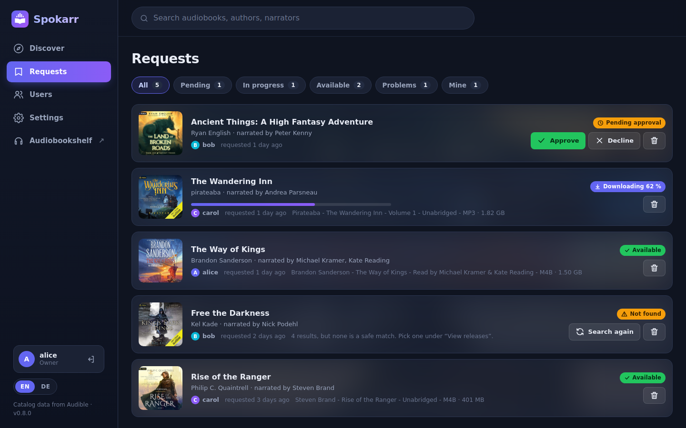
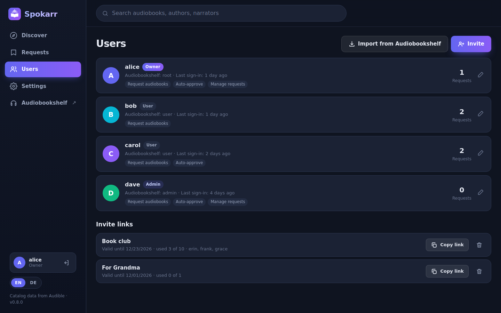

<p align="center"></p>

<h1 align="center">Spokarr</h1>

<p align="center">
  <b>Request audiobooks like you request movies in Seerr.</b><br>
  Spokarr finds the exact edition you want, downloads it and files it into your Audiobookshelf library.
</p>

<p align="center">
  <a href="https://github.com/BlugDeg/Spokarr/actions/workflows/docker.yml"></a>
  <a href="https://github.com/BlugDeg/Spokarr/releases"></a>
  
  
  
  
  
</p>

<p align="center"></p>

---

## Why Spokarr?

Readarr is built around *books*. Its metadata rarely knows narrators, editions or non-English titles, so
getting *the* recording you want – the unabridged one, read by your favourite narrator, in your
language – is guesswork.

Spokarr starts from the **Audible catalog** instead. You pick the exact edition, Spokarr looks for a
release that matches it on your indexers, sends it to SABnzbd and hands the finished book to
Audiobookshelf – already matched, with cover, chapters and narrator.

Everyone in your household signs in with their **Audiobookshelf account**, so there is nothing new to
set up for them.

## Features

**For listeners**
- 🔎 **Discover and search** the Audible catalog of any store (US, UK, DE, FR, …) – covers, narrators,
  length, series, abridged or unabridged.
- ➕ **One-tap requests** and a clear status for every book: pending, downloading with progress,
  available.
- 🎧 **Straight to listening**: “Listen in Audiobookshelf” opens the book in your library.
- 🔐 **Sign in with Audiobookshelf** – same username and password, no extra accounts. Spokarr never
  stores passwords.
- 📱 **Mobile first**, installable as a home-screen app. English and German interface.

**For admins**
- ✅ **Approval workflow** like Seerr: per-user permissions to request, auto-approve and manage requests.
- 👥 **User management** with roles, request counts and last sign-in – plus a one-click import of all
  Audiobookshelf users.
- 🧠 **Smart release matching**: every result is scored on title, narrator, language, abridged vs.
  unabridged, dramatizations and size per minute. “View releases” shows the score and the reasons, and
  lets you pick a release by hand.
- 🗂️ **Clean import**: downloads are moved to `Author/Title`, get a `metadata.json` and a cover,
  Audiobookshelf scans and matches the book, and it is tagged “Requested by &lt;name&gt;”.
- ⚙️ **Settings in the browser**: Audible store, discover rows, Audiobookshelf, SABnzbd and any number of
  Newznab indexers – each with a connection test.
- 🪶 **Lightweight**: plain Node.js without dependencies and JSON files instead of a database – runs fine
  on a Raspberry Pi.

## Screenshots

| Book details | Requests |
|---|---|
|  |  |
| **Users** | **Settings** |
|  |  |

<p align="center">
  
  &nbsp;
  
  &nbsp;
  
</p>

<p align="center"></p>

## How it works

```
 Audible catalog ──► you pick an edition ──► Newznab indexers ──► scored releases
                                                                        │
 Audiobookshelf ◄── scan + match + tag ◄── import to Author/Title ◄── SABnzbd
```

## Requirements

- [Audiobookshelf](https://www.audiobookshelf.org/) **2.26 or newer** – used for sign-in and as the library
- [SABnzbd](https://sabnzbd.org/)
- At least one Newznab-compatible indexer with an audiobook category
- Docker – or Node.js 20+

## Installation

### Docker

Ready-made images for **amd64** (PC, NAS) and **arm64** (Raspberry Pi 4/5) are published to the GitHub
Container Registry:

| Tag | Meaning |
|---|---|
| `ghcr.io/blugdeg/spokarr:latest` | latest release |
| `ghcr.io/blugdeg/spokarr:0.2` | latest 0.2.x release |
| `ghcr.io/blugdeg/spokarr:edge` | current `main` branch |

```bash
docker run -d --name spokarr --restart unless-stopped \
  -p 5057:5057 \
  -v ./data:/data \
  -v /path/to/media:/media \
  -e LIBRARY_DIR=/media/audiobooks \
  --user 1000:1000 \
  ghcr.io/blugdeg/spokarr:latest
```

### Docker Compose

```yaml
services:
  spokarr:
    image: ghcr.io/blugdeg/spokarr:latest
    container_name: spokarr
    restart: unless-stopped
    ports:
      - "5057:5057"
    volumes:
      - ./data:/data                 # settings, users, requests
      - /path/to/media:/media        # the disk with SABnzbd's downloads and your audiobooks
    environment:
      LIBRARY_DIR: /media/audiobooks # where Spokarr puts finished audiobooks
    user: "1000:1000"                # the user that owns your media files
```

```bash
docker compose up -d
```

**Updating:** `docker compose pull && docker compose up -d`. Your settings in `data/` are kept.

### Without Docker

```bash
git clone https://github.com/BlugDeg/Spokarr.git
cd Spokarr
DATA_DIR=./data LIBRARY_DIR=/path/to/audiobooks node server.mjs
```

### First start

Open `http://<host>:5057` and follow the setup:

1. **Connect Audiobookshelf** – enter its address as the Spokarr server reaches it.
2. **Sign in as an Audiobookshelf administrator.** You become the owner of Spokarr, and Spokarr creates
   its own API key in Audiobookshelf.
3. Under **Settings**, add **SABnzbd** and your **indexers** and choose the Audiobookshelf **library**.

In SABnzbd, create the category Spokarr uses (default `spokarr`). Put SABnzbd's download folder and the
library on the **same disk**, so imports are an instant move instead of a copy.

Other people can sign in right away with their Audiobookshelf accounts – or import them all under
**Users**.

## Configuration

Everything is configured in the web interface and stored in `data/settings.json`.

| Environment variable | Purpose |
|---|---|
| `PORT` | Port of the web interface (default `5057`) |
| `DATA_DIR` | Folder for settings, users and requests (default `/data`) |
| `LIBRARY_DIR` | Folder where finished audiobooks are placed (default `/audiobooks`) |

All other variables in [`.env.example`](.env.example) are optional and only read on the very first start
to pre-fill the settings – handy for automated deployments.

### Permissions

| Permission | Allows |
|---|---|
| Request audiobooks | Request books. |
| Auto-approve | Requests are downloaded right away instead of waiting for an admin. |
| Manage requests | See all requests, approve or decline them and pick releases by hand. |

Admins have every permission and can change settings. Audiobookshelf administrators become Spokarr admins
on their first sign-in; everyone else gets the default permissions from **Settings → General**.

### How releases are scored

| Signal | Effect |
|---|---|
| Share of title words found in the release name | up to +60; below 75 % a release is never picked automatically |
| Narrator's name in the release | +25 |
| Release names the book's language / another language | +10 / −50 |
| Dramatization or full-cast edition for a regular reading | −30 |
| Abridged release for an unabridged book | −25 |
| Implausibly small for the runtime | −30 |

A release is picked automatically at 50 points or more. Everything else can be chosen under
**View releases**.

## Security notes

- Passwords are checked by Audiobookshelf and never stored. Sessions are random tokens in an
  `HttpOnly`, `SameSite=Lax` cookie; only their hashes are saved.
- Failed sign-ins are rate-limited (8 attempts per 15 minutes and IP).
- API keys are stored in `data/settings.json` with file mode `600` and never sent to the browser.
- Put Spokarr behind HTTPS (e.g. a reverse proxy) if you expose it to the internet.

## Translating

Translations live in [`public/i18n.js`](public/i18n.js). Copy the `en` block, translate it and add the
language to `LANGUAGES` – pull requests are very welcome.

## Legal

Spokarr is a search and automation tool. It does not host, index or provide any content. You are
responsible for complying with the laws of your country and the terms of the services you connect.
Audible is a trademark of Audible, Inc. Spokarr is not affiliated with Audible, Amazon or
Audiobookshelf. Covers in the screenshots are shown for illustration and belong to their publishers.

## License

[MIT](LICENSE)
